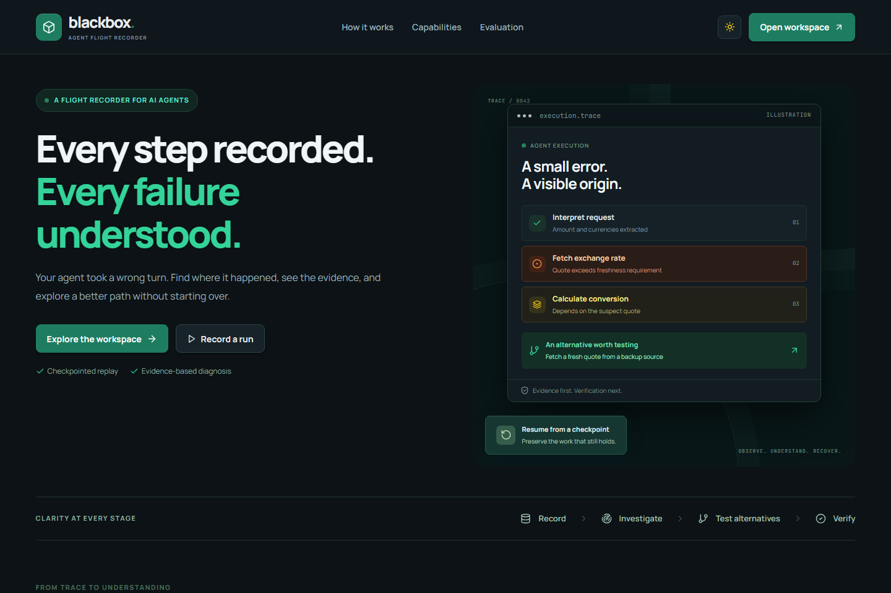
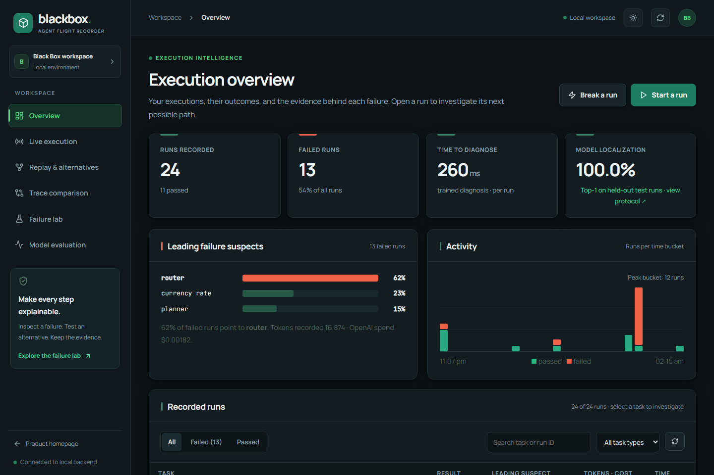
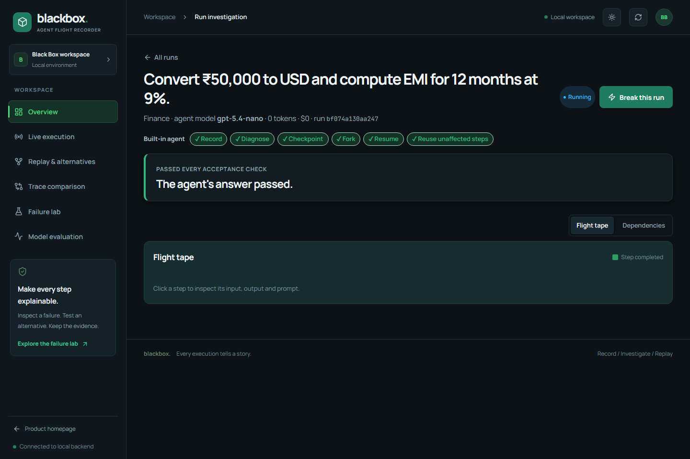
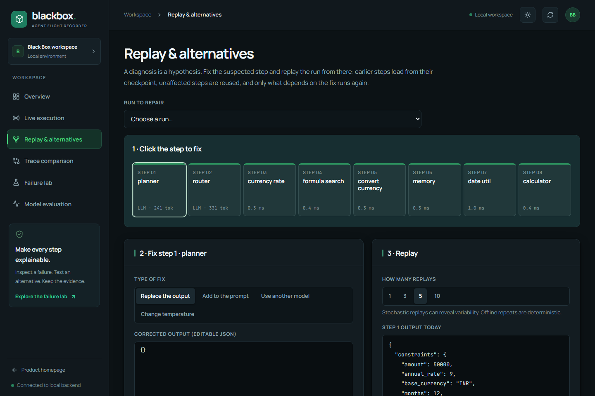

# BlackBox

### A flight recorder and debugger for AI agents

Record an agent run, investigate where it went wrong, and test a fix from a saved checkpoint. BlackBox connects execution traces, failure diagnosis, and replay in one local workspace.

**Personal project maintained by [Priyanshu Gupta](https://github.com/priy-anshugupta).** Originally developed with the NeuralForge team for the Bit and Build hackathon; this repository continues that work as a personal portfolio project. Original authorship and Git history are preserved. See [project origins](docs/PROVENANCE.md).

[Quick start](#quick-start-windows-powershell) · [Demo walkthrough](#try-the-workflow) · [Architecture](docs/ARCHITECTURE.md) · [Evaluation](docs/EVALUATION.md) · [Contributing](CONTRIBUTING.md)

## Preview



<details>
<summary>Explore the investigation workspace</summary>





</details>

Screenshots are captured from the existing project UI; appearance can vary with the selected theme and local data.

## Why I am continuing this project

Agent failures often show up several steps after the original mistake. A stale tool response can reach a calculator, a planner can lose a constraint, or a final answer can hide an earlier error. A final transcript alone makes these problems difficult to investigate.

BlackBox keeps the intermediate inputs, outputs, state, and dependencies so a developer can follow the failure backward, inspect the evidence, and compare a proposed repair against an independent check. My focus for this personal continuation is making that workflow easier to run, understand, and extend.

## Features

- **Execution recording:** per-step inputs, outputs, dependencies, token usage, and checkpoints.
- **Failure investigation:** ranked suspect steps, observable evidence, and dependency views.
- **Checkpoint replay:** test output or prompt patches while preserving the original incident.
- **Alternative fixes:** compare candidate repairs using independent acceptance checks.
- **Live recovery:** prefix checks can trigger bounded repair attempts before dependent steps run.
- **Developer integrations:** a LangGraph wrapper, Claude Code ingestion, MCP tools, and OpenTelemetry export.
- **Local dashboard:** run history, incident details, replay, comparisons, evaluation, and light/dark themes.
- **Review and export:** incident reports, regression-test export, and reviewed labels for later training.

## How it works

```text
Agent execution → Step recorder → SQLite traces + checkpoints
                                      ↓
                            Diagnosis + evidence
                                      ↓
                     Candidate fix → Fork / partial replay
                                      ↓
                       Independent checks → Comparison
```

The built-in engine supports selective reuse. External LangGraph replay uses native checkpoints and LangGraph execution semantics; its replay capabilities differ from the built-in engine. See [architecture](docs/ARCHITECTURE.md).

## Tech stack

| Layer | Technologies |
| --- | --- |
| Backend | Python, FastAPI, Uvicorn, Pydantic |
| Agent execution | LangGraph; sandbox, OpenAI, and Ollama providers |
| Diagnosis | PyTorch Transformer, LightGBM, autoencoder, sentence-transformer features |
| Storage | SQLite traces, checkpoints, and usage ledger |
| Dashboard | React 19, Vite, Tailwind CSS, Lucide icons |
| Observability | OpenTelemetry and OpenInference-style span attributes |
| Verification | pytest, FastAPI TestClient, dashboard production build |
| Packaging | Docker and Docker Compose |

## Requirements

- Python **3.11 or 3.12 recommended**; package metadata permits Python 3.10+.
- Node.js **22 LTS** and npm for the dashboard.
- Git and sufficient disk space for Python/ML dependencies and feature-model caches.
- An internet connection for initial dependency and feature-model downloads. The sandbox agent itself needs no API key.

A GPU is optional. The commands below use CPU PyTorch. Diagnosis can download pretrained feature encoders on first use; see [setup notes](docs/SETUP.md) for offline behavior.
